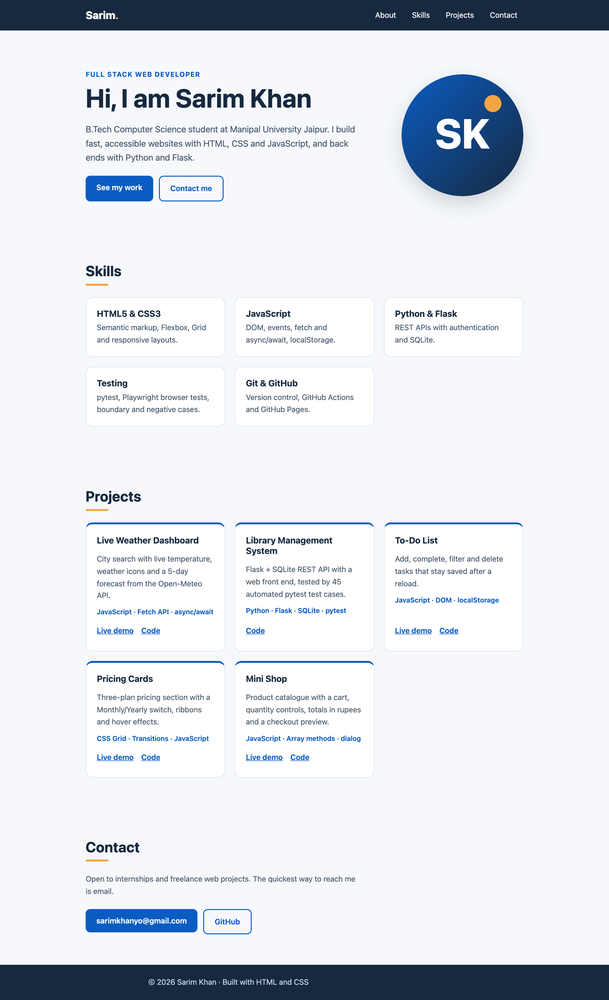
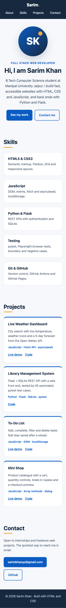

# Personal Portfolio Landing Page

InternCircle internship, **Fullstack Web Development, Project 1**.
Intern: Sarim Khan

**Live:** https://sarimkhan-sketch.github.io/portfolio/
**Code:** https://github.com/sarimkhan-sketch/portfolio

One-page developer portfolio with an introduction, skills, projects and contact links, written in semantic
HTML5 and responsive CSS (no frameworks, no JavaScript).

## Requirements

| Guide requirement | How it is done |
|---|---|
| Semantic HTML5 | `header` > `nav`, `main` > `section#about/#skills/#projects/#contact`, `article` per project, `footer`; one `h1`, then `h2`/`h3` in order |
| Flexbox | Navigation bar, hero (text + avatar), buttons, project links |
| Grid | Skills and project cards: `grid-template-columns: repeat(auto-fit, minmax(15rem, 1fr))` |
| Mobile responsive | Viewport meta tag; `@media (max-width: 700px)` stacks the nav and hero and enlarges tap targets; rem units, no fixed widths |
| Polish | `scroll-behavior: smooth` (off for reduced motion), hover effects, visible `:focus-visible` outline, skip link, sticky header |
| Images | The avatar is a small SVG with meaningful `alt` text |

Checked in Chrome at **360px, 768px and 1280px**: no sideways scrolling, all sections reachable from the menu.
The brand blue `#0b5cc2` on white and white on navy `#16293f` both pass WCAG AA contrast (above 4.5:1).

## Run it locally (Windows)

Download the project (green **Code** button → **Download ZIP** → right-click → *Extract All*) and
double-click `index.html`. It opens in the browser; nothing to install.

With VS Code (as in the guide): install the **Live Server** extension, *File → Open Folder…*, then
right-click `index.html` → **Open with Live Server**.

## Submission note: a design decision I am proud of

> I kept the page to a three-colour palette (navy, blue and a warm orange accent) and used one card
> style for both skills and projects, laid out with a single CSS Grid rule
> (`repeat(auto-fit, minmax(15rem, 1fr))`). The same rule gives three columns on a laptop, two on a
> tablet and one on a phone without extra media queries, so the only breakpoint I needed was for the
> navigation and hero. On phones the menu links get larger tap areas and the avatar moves above the text.
